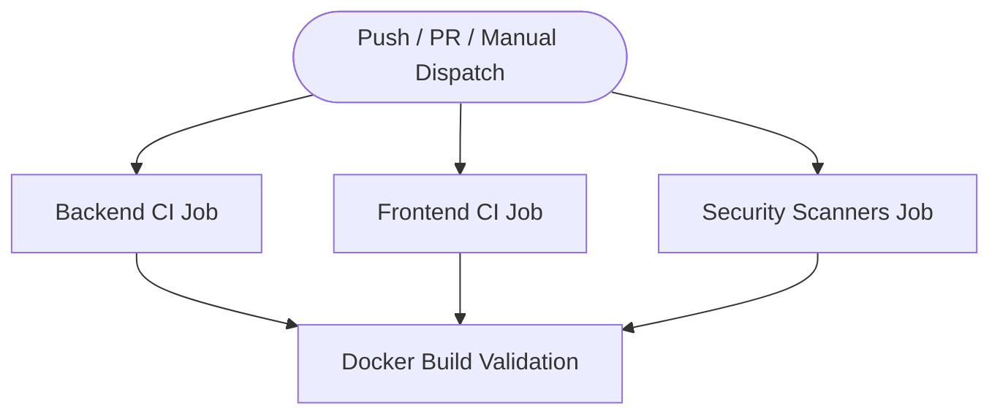

# Veritor CI/CD Pipeline

This document outlines the architecture, security practices, workflows, and operational procedures for the continuous integration and continuous delivery (CI/CD) pipeline in Veritor.

---

## 1. Pipeline Overview

Veritor uses GitHub Actions for automated continuous integration, multi-layer security scanning, container packaging, and automated releases.

| Pipeline | Workflow File | Trigger | Primary Objectives |
| :--- | :--- | :--- | :--- |
| **Continuous Integration (CI)** | `.github/workflows/ci.yml` | Pull requests to `main`, pushes to `main`, `workflow_dispatch` | Fast feedback, linting, formatting, type checking, unit tests, coverage, security audits, Docker build validation |
| **Continuous Delivery (CD)** | `.github/workflows/release.yml` | Semantic version tags (`v*.*.*`), manual `workflow_dispatch` | Build production multi-arch images, tag with semver & Git SHA, publish to GitHub Container Registry (GHCR), publish GitHub Release |

---

## 2. Continuous Integration Workflow (`ci.yml`)

The CI workflow runs across four parallel and staged jobs:



### Job 1: Backend CI
- **Environment**: Ubuntu Latest, Python 3.12 with pip cache keyed on `backend/pyproject.toml`.
- **Linting & Formatting**:
  - `ruff check .` ensures adherence to modern Python syntax, PEP 8, and code quality standards.
  - `ruff format --check .` validates code formatting.
- **Type Checking**:
  - `mypy` statically checks typed code across the FastAPI application.
- **Testing & Coverage**:
  - `pytest --cov=app --cov-report=xml --cov-report=term` executes the test suite.
  - Generates coverage reports and uploads `backend/coverage.xml` as an artifact (`backend-coverage-report`, 14-day retention).

### Job 2: Frontend CI
- **Environment**: Ubuntu Latest, Node.js 24 with npm cache keyed on `frontend/package-lock.json`.
- **Dependency Installation**: `npm ci` ensures reproducible installations strictly against the lockfile.
- **Code Quality & Typing**:
  - `npm run lint` (ESLint 9).
  - `npm run typecheck` (`tsc --noEmit`).
- **Tests**:
  - `npm test` runs Node test runner against unit test suites (`tests/**/*.test.mjs`).
- **Production Bundle**:
  - `npm run build` compiles Next.js 16 to verify production compilation and asset generation.

### Job 3: Security Checks
- **Static Application Security Testing (SAST)**:
  - `bandit -r backend/app -ll -ii` scans backend code for security vulnerabilities with medium/high confidence and severity thresholds.
- **Software Composition Analysis (SCA)**:
  - `pip-audit backend/` checks Python dependencies against the PyPI vulnerability database.
  - `npm audit --audit-level=high` checks npm dependencies for high and critical CVEs.
- **Vulnerability & Secret Scanning**:
  - `aquasecurity/trivy-action` scans the workspace filesystem for exposed secrets, API keys, credentials, and known CVEs.

### Job 4: Docker Build Validation
- Validates that both `backend/Dockerfile` and `frontend/Dockerfile` build successfully with Buildx without publishing to any registry.
- Uses GitHub Actions layer caching (`type=gha`) to accelerate subsequent builds.

---

## 3. Continuous Delivery & Release Workflow (`release.yml`)

Triggered on version tags matching `v*.*.*` (e.g., `v1.0.0`) or via manual workflow dispatch:

1. **Authentication**:
   - Logs into GitHub Container Registry (`ghcr.io`) using the standard ephemeral `${{ secrets.GITHUB_TOKEN }}`.
   - Requires minimal repository permissions (`contents: write`, `packages: write`).
2. **Metadata & Tagging**:
   - Extracts semver patterns: `vX.Y.Z`, `X.Y.Z`, `X.Y`.
   - Generates commit SHA tags: `sha-<short-sha>` for traceability.
   - Tags default release with `latest`.
3. **Container Publication**:
   - Pushes backend image to `ghcr.io/<owner>/veritor-backend:<tags>`.
   - Pushes frontend image to `ghcr.io/<owner>/veritor-frontend:<tags>`.
4. **GitHub Release Publication**:
   - Automatically drafts and publishes a GitHub Release using `softprops/action-gh-release@v2`.
   - Generates release notes from commit history and pull requests between tags.

---

## 4. Local Execution & Verification

Run these commands locally before submitting pull requests:

### Backend
```bash
cd backend

# Lint and format
ruff check .
ruff format --check .

# Type checking
mypy

# Tests and coverage
pytest --cov=app --cov-report=term-missing

# Security audit
bandit -r app -ll -ii
pip-audit .
```

### Frontend
```bash
cd frontend

# Clean lockfile install
npm ci

# Linting & Type check
npm run lint
npm run typecheck

# Tests & Build
npm test
npm run build

# Dependency security audit
npm audit --audit-level=high
```

### Docker
```bash
# Build backend image
docker build -t veritor-backend:local ./backend

# Build frontend image
docker build -t veritor-frontend:local ./frontend

# Run full stack with Ollama
docker compose up --build
```

---

## 5. Security Principles & Secrets Configuration

1. **Least Privilege**:
   - CI runs with `permissions: contents: read`.
   - Release runs with scoped `contents: write` (for release notes) and `packages: write` (for GHCR).
2. **No Hardcoded Secrets**:
   - Container authentication relies exclusively on the native GitHub Actions `GITHUB_TOKEN`.
   - No external registry secrets, passwords, or personal access tokens are stored in repository files.
3. **Container Hardening**:
   - `backend/Dockerfile` runs under non-root user `appuser` (UID 10001).
   - `frontend/Dockerfile` uses multi-stage alpine builds and runs under unprivileged user `nextjs` (UID 1001).
   - Healthcheck directives verify service responsiveness.
